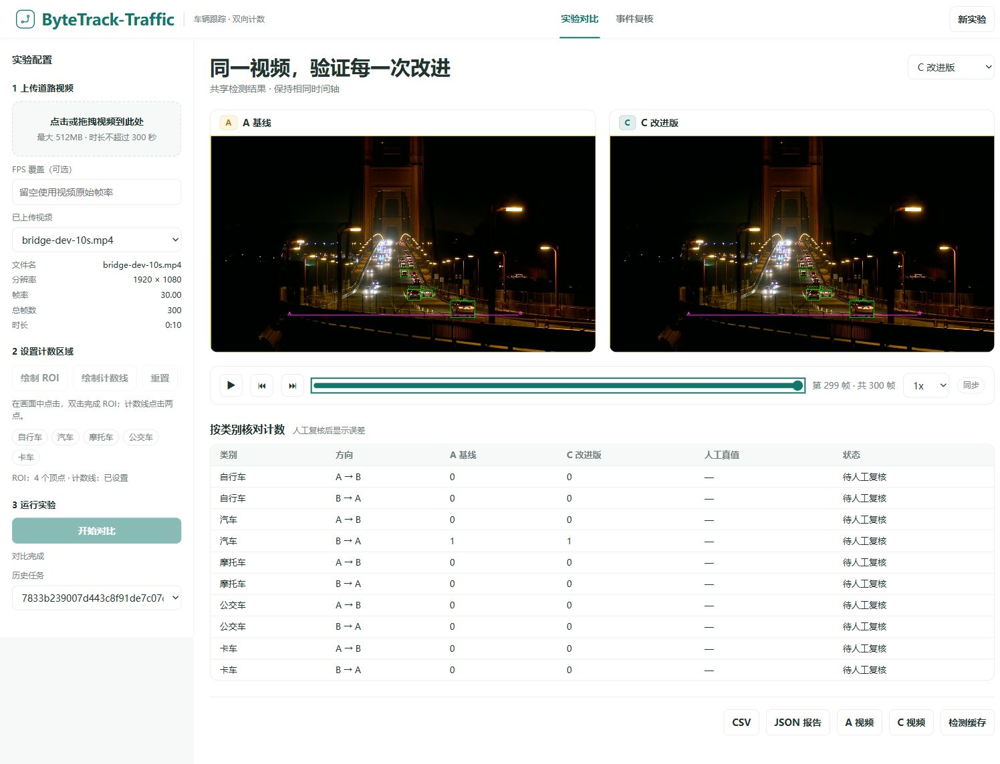
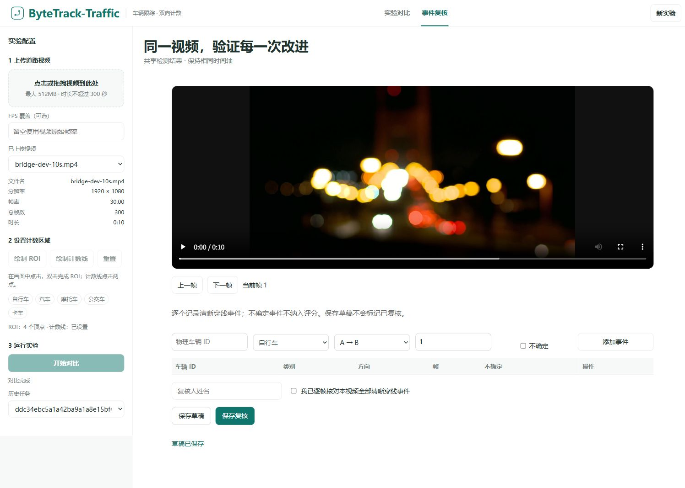
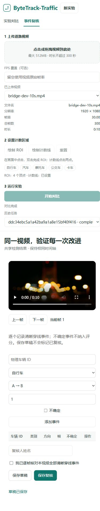

# QA 技术报告

## 摘要

本报告记录 ByteTrack-Traffic 实验对比功能在 2026-10-18 于 Windows 环境下的实际 QA 验证结果。共执行 88 项测试，全部通过：核心 40 项、视频 6 项、评估 14 项、API 18 项、处理器 10 项。浏览器端通过内置 IAB（CUA）在真实桌面与移动视口完成交互验证。当前状态为工程预览版，非 v0.1.0 正式发布；正式发布所需的留出集真值评估尚未完成。

## 环境

- 日期：2026-10-18
- 操作系统：Windows
- Python：3.12
- PyTorch：2.5.1 + cu121
- GPU：RTX 3070 Laptop 8GB
- 浏览器：内置 IAB（CUA），未使用 Playwright 回退（浏览器插件技能未列出）
- 桌面视口：1512x1040；实际面板 1082x1040
- 移动视口：390x844
- 页面地址：http://127.0.0.1:8765/
- 页面标题：ByteTrack-Traffic · 实验对比

## 变更

- 补全复核页的 getHealth 接口调用，消除由此产生的 404。
- 验证上传、运行、同步、草稿保存与 CSV 导出完整流程。
- 确认时间轴末端钳制、模式切换与步进同步行为。
- 确认空草稿保存可用，且未产生虚假人工标注或准确率声明。

## 检查表

| 项目 | 结果 |
| --- | --- |
| 测试总数 | 88 项全部通过 |
| 核心 | 40 项通过 |
| 视频 | 6 项通过 |
| 评估 | 14 项通过 |
| API | 18 项通过 |
| 处理器 | 10 项通过 |
| 页面非空白 | 通过 |
| 无错误覆盖层 | 通过 |
| 控制台新错误 | 无（修复后） |
| 原生选择器上传 | 真实 10 秒 1080p 300 帧 fps30 |
| 进度状态 | queued/running/completed 正常 |
| 配置冻结 | 通过 |
| 历史恢复 | 视频+几何恢复通过 |
| 时间轴末端钳制 | 299/300 |
| B 切换步进 | 仍可播放步进 |
| A=B 时间 | 9.933333，readyState 4 |
| A/C 下一帧 | 均为0.033333秒 |
| 同步状态 | 正确 |
| CSV 浏览器下载 | 实际 counts.csv，解析 30 行 |
| CSV 覆盖 | 3 模式 * 5 类 * 2 方向 |
| 原视频逐帧复核 | 当前帧和标注输入均为1 |
| 临时未保存 QA 事件 | 帧 1 存储后保存前移除 |
| 最终真值 | 空，reviewed=false，绑定 config/source/job |
| 空草稿保存 | 可用 |
| 人工审查确认点击 | 未进行 |
| 移动端水平溢出 | 无（390 -> scrollWidth 375） |
| 移动端审查视频宽度 | 310.67，容器 342.67 |
| 移动端垂直滚动 | 侧栏堆叠导致，属预期 |

## 交互证明

- 顶部标题栏与 290 侧栏忠实于已接受概念稿。
- 实际使用公开 CC BY 示例素材，非设计示意图，属有意选择。
- A→B / B→A 标签几何准确，与概念稿的进入/退出标注存在有意偏差。
- 初始失焦示例与夜间设定为真实素材，未伪装为白天。
- 视觉配对已对照已接受概念稿与最终 view_image 检查。

## 截图链接

截图由编排器提交至以下路径：

- docs/images/comparison-desktop.png
- docs/images/review-desktop.png
- docs/images/review-mobile.png

## 媒体归属

- 来源：Editor，CC BY 3.0，桥夜景素材来自 Commons。
- 作者：Editor
- 页面：https://www.youtube.com/user/Editor
- 文件：https://commons.wikimedia.org/wiki/File:Traffic_on_bridge_at_night.webm
- 许可：https://creativecommons.org/licenses/by/3.0/
- 图像包含项目 UI 与标注改动，未提交原始视频或权重。
- 媒体归属已在 README/源码与 docs 清单中说明。

## 剩余风险

- 当前活动流程测试覆盖上传/运行/同步/草稿/导出；完整 5 类评估未完成。
- Linux CPU 自动测试已通过：[运行记录](https://github.com/ShingStars/ByteTrack-Traffic/actions/runs/39106005266)（代码提交 6711528）。
- 超过 300 秒的拒绝与 API 测试已覆盖，但超大 4K 剪辑性能未测量。
- WebM 元数据可能需要 FPS 覆盖与先验归一化，属已知清单项。
- 正式留出集评估待完成：5 类各 5 个清晰穿越，独立摄像头/开发数据，运行前冻结参数，人工用户最终审查。
- RTSP 与 ReID 训练属未来范围外。
- 控制台存在一条修复前缺失 getHealth 导致的历史 404，修复后无新错误；该历史项标记为已解决，未伪造为零旧日志。
